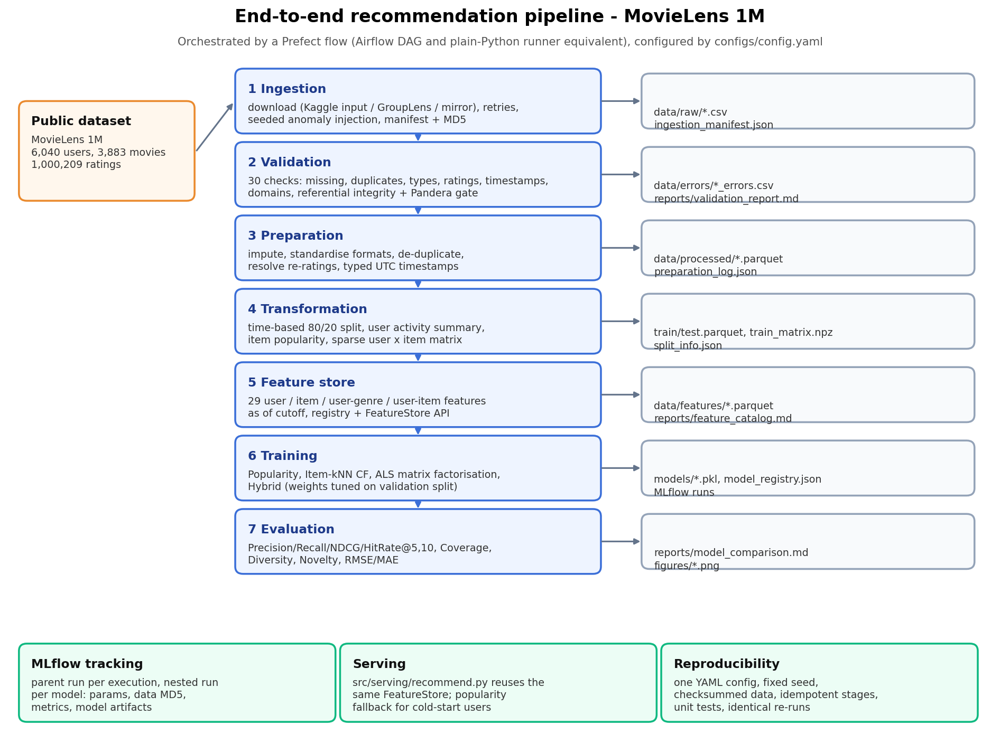

# End-to-End Data Management Pipeline for a Recommendation System

DM4ML Assignment 2 - Anagha N (2025AG05670)

Modular, reproducible pipeline on **MovieLens 1M**: ingestion -> validation -> preparation -> transformation -> feature store -> training (MLflow) -> evaluation, orchestrated with **Prefect** (an equivalent Airflow DAG is included).



## Results (K = 10, time-based test set, 1131 users)

| Model | Precision@10 | Recall@10 | NDCG@10 | Coverage@10 | Diversity@10 | RMSE | MAE |
|---|---|---|---|---|---|---|---|
| Popularity (baseline) | 0.1950 | 0.0498 | 0.2102 | 0.037 | 0.656 | 0.9612 | 0.7612 |
| Item-kNN CF | 0.1634 | 0.0521 | 0.1834 | 0.211 | 0.614 | n/a | n/a |
| Matrix factorisation (ALS) | 0.0828 | 0.0217 | 0.0845 | 0.153 | 0.712 | 0.8956 | 0.6963 |
| Hybrid (CF + content + popularity) | 0.2138 | 0.0604 | 0.2310 | 0.044 | 0.680 | n/a | n/a |

Best model by NDCG@10: **Hybrid (CF + content + popularity)** (+9.9% vs the popularity baseline). ALS has the best rating prediction (RMSE 6.8% below the item-average baseline). Full tables: [reports/model_comparison.md](reports/model_comparison.md).

## Setup

```bash
git clone https://github.com/2025ag05670-sys/DM4MLAssignment2
cd recommendation-pipeline
python -m venv .venv && source .venv/bin/activate      # Windows: .venv\Scripts\activate
pip install -r requirements.txt
```

## Run

```bash
python run_pipeline.py                         # all 7 stages (MovieLens is downloaded automatically)
python run_pipeline.py --stage validation      # one stage;  --from-stage training  to resume
python dags/prefect_flow.py                    # Prefect flow (add --serve for a daily 02:00 schedule)
prefect server start                           # optional UI at http://127.0.0.1:4200 (set PREFECT_API_URL first)
mlflow ui --backend-store-uri sqlite:///mlflow.db   # experiment tracking UI at http://127.0.0.1:5000
python -m src.serving.recommend --user-id 6040 --k 10
pytest -q tests
```
Airflow: copy `dags/airflow_dag.py` to `$AIRFLOW_HOME/dags`, export `RECSYS_PROJECT_ROOT=$(pwd)`, run `airflow standalone`.
Kaggle: import `2025AG05670_DM4ML_Assignment2.ipynb`, turn Internet on, and Run All.

## Structure

```
configs/config.yaml        single source of truth (paths, rules, split, hyper-parameters, seed)
src/ingestion/             download, anomaly injection, manifest + checksums
src/validation/            rule engine (30 checks) + Pandera schema gate + error datasets
src/preparation/           cleaning, imputation, standardisation, de-duplication
src/transformation/        time-based split, activity summary, popularity, user-item matrix
src/features/              feature registry (catalog) + FeatureStore (training and serving)
src/training/              models, validation tuning, MLflow tracking
src/evaluation/            metrics + model comparison
src/serving/               recommendations reusing the feature store
dags/                      prefect_flow.py, airflow_dag.py
data/{raw,processed,features,errors}   models/   reports/   docs/   tests/
```

## Deliverables

| Deliverable | Location |
|---|---|
| Source code organised into modules | `src/`, `dags/`, `run_pipeline.py` |
| requirements.txt | `requirements.txt` |
| Architecture diagram | `docs/architecture.png` |
| Data validation report and logs | `reports/validation_report.md`, `data/errors/`, `logs/` |
| Feature catalog (table) | `reports/feature_catalog.md` |
| Model evaluation results | `reports/model_comparison.md`, `reports/figures/model_comparison_k10.png` |
| Orchestration workflow + successful run | `dags/prefect_flow.py`, `reports/figures/orchestration_run.png`, `logs/prefect_run.log` |
| Final report (PDF) | `reports/Final_Report.pdf` |

## Reproducibility
One YAML config and a fixed seed (42); raw files are MD5-checksummed; MLflow logs the training-data MD5 and feature version. A clean orchestrated re-run reproduced the interactive metrics exactly (True).

## Dataset
MovieLens 1M, GroupLens Research: https://grouplens.org/datasets/movielens/1m/ (download: https://files.grouplens.org/datasets/movielens/ml-1m.zip).
F. M. Harper and J. A. Konstan, "The MovieLens Datasets: History and Context", ACM TiiS 5(4), 2015.
