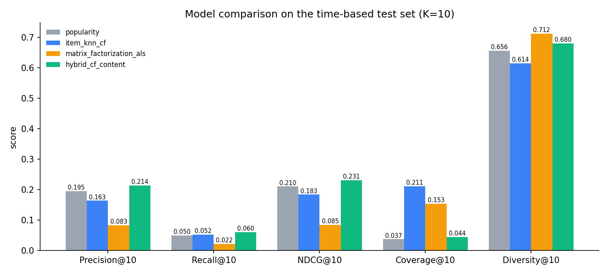

# Model Evaluation Results

Test set: interactions after `2000-12-02T14:58:06+00:00` (time-based split), 1131 warm users with at least one relevant item (rating >= 4). Already-seen items are excluded from every ranking. Catalogue size = 3662 items.

## K = 10

| model | precision_at_10 | recall_at_10 | ndcg_at_10 | hit_rate_at_10 | coverage_at_10 | diversity_at_10 | novelty_at_10 | rmse | mae |
| --- | --- | --- | --- | --- | --- | --- | --- | --- | --- |
| popularity | 0.1950 | 0.0498 | 0.2102 | 0.6198 | 0.0369 | 0.6559 | 1.4151 | 0.9612 | 0.7612 |
| item_knn_cf | 0.1634 | 0.0521 | 0.1834 | 0.5880 | 0.2108 | 0.6143 | 2.2595 | n/a | n/a |
| matrix_factorization_als | 0.0828 | 0.0217 | 0.0845 | 0.3996 | 0.1529 | 0.7123 | 4.7724 | 0.8956 | 0.6963 |
| hybrid_cf_content | 0.2138 | 0.0604 | 0.2310 | 0.6543 | 0.0440 | 0.6799 | 1.5003 | n/a | n/a |

## K = 5

| model | precision_at_5 | recall_at_5 | ndcg_at_5 | coverage_at_5 | diversity_at_5 |
| --- | --- | --- | --- | --- | --- |
| popularity | 0.2055 | 0.0266 | 0.2181 | 0.0243 | 0.5965 |
| item_knn_cf | 0.1873 | 0.0317 | 0.1990 | 0.1592 | 0.5758 |
| matrix_factorization_als | 0.0852 | 0.0112 | 0.0850 | 0.1128 | 0.7004 |
| hybrid_cf_content | 0.2352 | 0.0347 | 0.2445 | 0.0287 | 0.6478 |

**Best model by ndcg_at_10: `hybrid_cf_content`**

RMSE/MAE are computed on every warm test rating; the popularity model predicts the item's Bayesian-average rating, which acts as the rating baseline for matrix factorisation. Ranking-only models (item-kNN, hybrid) do not predict ratings (n/a).

